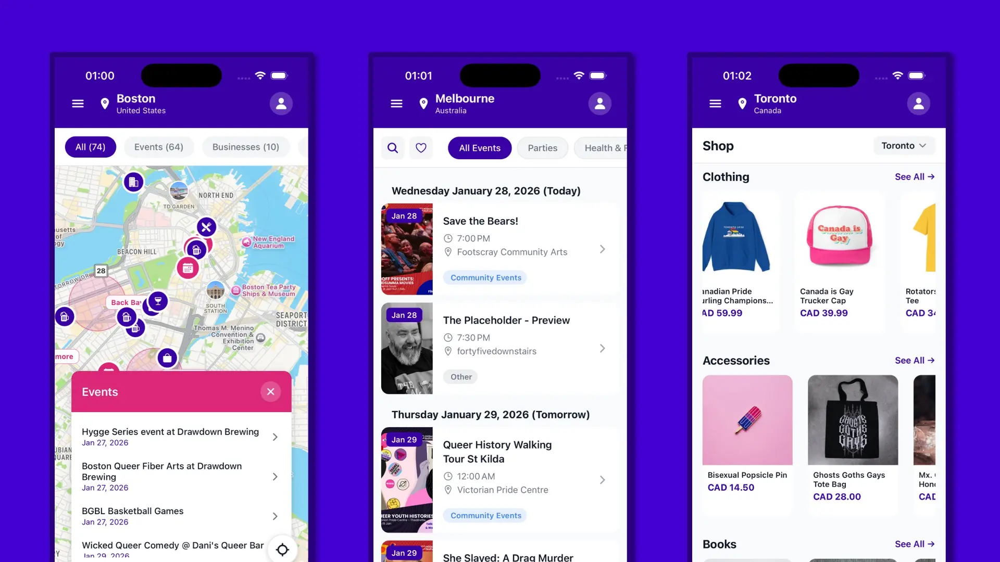
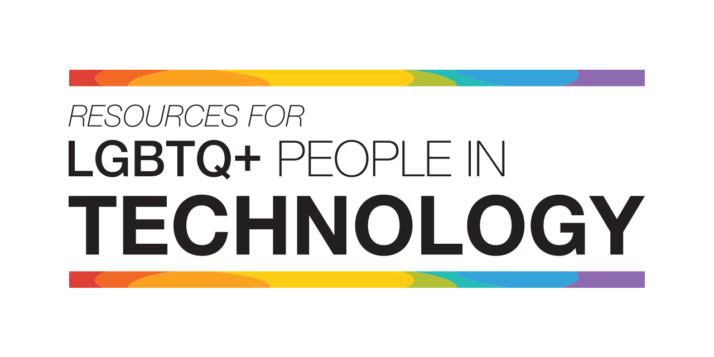

# Resources for LGBTQ+ people working in technology 🏳️‍🌈

> ### Sponsored by [The Gay Agenda](https://thegayagenda.fyi)
> 
>
> **Find LGBTQ+ events near you at [thegayagenda.fyi](https://thegayagenda.fyi)**

---

This repository contains a list of resources for LGBTQ+ people working in the tech field. Pull requests are *very* welcome.

## Table Of Contents
1. [Online Communities](#online-communities)
2. [Community Organizations](#community-organizations)
3. [Entrepreneurial Resources](#entrepreneurial-resources)
4. [Events](#events)

## Contributions
Contributions are welcome - submit a pull request to add or modify communities. If this gets to be popular, we'll look into a way to distinguish between LGBTQ-friendly, and dedicated LGBTQ+ resources.

## Online Communities
Communities and resources that are primarily digital.

| Name | Type | Summary |
| --- | --- | --- |
| [lgbtq.technology](https://lgbtq.technology) | Slack Community | A Slack workspace for LGBTQ+ people in tech. An invite is required and can be requested from the site. |
| [Queer Coders](https://queercoders.com/) | Online Forum | An online forum and community for LGBTQ+ programmers and developers. |
| [Queer Code](https://queer-code.org/) | Slack Community | A community of queer coders with a global Slack group and local meetups. |

## Community Organizations
Organizations that meet up in real life.

| Organization | Location | Summary |
| --- | --- | --- |
| [Out In Tech](https://outintech.com/) | New York City, Los Angeles, San Francisco, London, Portland, Chicago, Washington DC, Boston, and Austin | Nonprofit creating opportunities for LGBTQ+ people in tech with 40,000+ members, offering mentorship, events, and a Leadership Institute. |
| [Lesbians Who Tech & Allies](https://lwtsquad.com) | New York City | 50,000+ member community for queer women, nonbinary, trans, and gender nonconforming people in tech, hosting an annual summit. |
| [LGBTQ2+ Launching Into Tech](https://www.meetup.com/LGBTQ-Launching-into-Tech/) | Vancouver | A meetup group with the mission to support LGBTQ2+ members of the Vancouver community exploring tech careers. |
| [Out Professionals](https://outprofessionals.org/) | New York City | The leading nonprofit LGBTQ networking organization in the USA, hosting regular professional events. |
| [QueerJS](https://queerjs.com/) | Different cities in Europe and the US | A meetup series where everyone is encouraged to attend, but where all speakers are queer. |
| [Queer Tech NYC](https://www.meetup.com/queer-tech-nyc/) | New York City | A networking and mentorship meetup group empowering LGBTQ2S+ people in tech. |
| [Queer Tech Club](https://queertechclub.com/) | Chicago | A 501(c)(7) organization providing professional development and networking for LGBTQ+ technologists. |
| [StartOut ATX](https://startout.org/) | Austin | StartOut's Austin chapter, hosting regular events and coworking sessions for LGBTQ+ people in the Austin tech scene. |
| [oSTEM](https://www.ostem.org/) | United States, Abroad (100+ Chapters) | An organization empowering LGBTQ people in STEM to succeed personally, academically, and professionally. |
| [QueerTech](https://queertech.org) | Montreal | QueerTech is the home for all queer peoples and their allies in the technology industry, supporting career discovery, growth, and leadership. |
| [Pride in STEM](https://prideinstem.org/) | UK | A UK charity run by LGBTQIA+ scientists and engineers, organizing events, grants, and programs to support LGBTQ+ people in STEM fields. |
| [Unicorns in Tech](https://www.unicornsintech.com) | Germany | A 4,000+ member LGBTIQ+ tech community connecting people through monthly afterwork events and an annual summit in Berlin. |
| [LGBT Tech](https://www.lgbttech.org/) | United States | National organization advancing digital inclusion for LGBTQ+ communities through programs like PowerOn (tech distribution) and PATHS (STEAM career inspiration). |
| [Out for Undergrad (O4U)](https://www.outforundergrad.org/) | United States | Nonprofit hosting free annual conferences (Engineering, Digital, Business, Life Sciences) for high-achieving LGBTQ+ undergraduates. |

## Entrepreneurial Resources
Resources for entrepreneurs, such as accelerators.

| Name | Type | Location | Summary |
| --- | --- | --- | --- |
| [StartOut](https://startout.org/) | Organization | San Francisco, New York City | The largest national organization supporting LGBTQ+ entrepreneurs, with 25,000+ community members. |
| [StartOut - Growth Lab](https://startout.org/growth-lab/) | Accelerator | Virtual | The only LGBTQ+-specific accelerator, a five-month program co-sponsored by J.P. Morgan, having helped 100+ companies since 2017. |
| [TransTech Social Enterprises](https://www.transtechsocial.org/) | Incubator | United States | A co-learning and co-working community empowering LGBTQ+ talent through education and employment, with a focus on transgender people. |
| [Gaingels](https://gaingels.com) | Venture Syndicate | New York, San Francisco, Los Angeles, Toronto, London | The leading LGBTQIA+ venture investment syndicate, with $900M+ invested across 2,600+ rounds and a portfolio including 70+ unicorns. |
| [NGLCC - National LGBT Chamber of Commerce](https://www.nglcc.org/) | Organization | Washington, D.C. | An advocacy organization dedicated to expanding economic opportunities and advancements for LGBT people. |
| [Canadian Queer Chamber of Commerce (CQCC)](https://cglcc.ca) | Organization | Canada | Formerly CGLCC, an advocacy organization empowering and connecting 100,000+ businesses in the 2SLGBTQI+ community. |
| [CQCC Supplier Diversity Program](https://cglcc.ca/certification/) | Supplier Diversity Certification | Canada | A program that certifies for-profit businesses as LGBTQ+ suppliers, connecting them with customers who would like to do business with them. |

## Events
Recurring events related to LGBTQ+ people in technology.

| Name | Type | Location | Summary |
| --- | --- | --- | --- |
| [QWER Hacks](https://www.qwerhacks.com/) | Hackathon | Los Angeles (UCLA) | MLH's first collegiate LGBTQIA+ hackathon, held annually at UCLA. |
| [TransCode](https://www.transcode.org/) | Hackathon | Hybrid (Online + In-Person) | A hackathon empowering the transgender and gender diverse community through technology, the spiritual successor to Trans*H4CK. |
